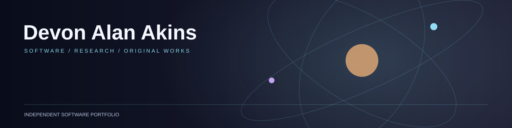

# Devon Alan Akins

> **Portfolio index · November 3, 2026:** This is a project registry, not a deployment or proof of production readiness. Each linked repository tracks its own source, reviews, and release gates.

**Author, software builder, and founder of [Anevum](https://anevum.com).**

I make open-source web software, interactive games, creative tools, and fictional worlds. Anevum is my long-term creative studio; I also build independent personal and family projects and software for real business needs.

[Personal website](https://devonakins.com) · [Anevum](https://anevum.com) · [All repositories](https://github.com/devonalanakins?tab=repositories)

---

## Selected work

| Project | What it is | Source |
| --- | --- | --- |
| **Anevum** | Family creative studio, fictional universe, and web experiences | [anevum-web](https://github.com/devonalanakins/anevum-web) |
| **DevonAkins.com** | My personal website and public workbench | [devonakins.com](https://github.com/devonalanakins/devonakins.com) |
| **Brandle** | A personal five-letter browser game with offline support and local progress | [brandle](https://github.com/devonalanakins/brandle) |
| **Brandicade** | A family game collection; source recovery is in progress | [brandicade](https://github.com/devonalanakins/brandicade) |
| **IdeaFlow** | Idea capture and meeting software; source reconciliation is in progress | [ideaflow](https://github.com/devonalanakins/ideaflow) |
| **Squelch** | Touch-native audio and DAW vision; engineering prototypes in draft | [squelch](https://github.com/devonalanakins/squelch) |
| **AIEI** | AI engineering integrity and evidence review toolkit | [aiei](https://github.com/devonalanakins/aiei) |
| **RHEN** | Deterministic financial systems research; risk-gated | [rhen](https://github.com/devonalanakins/rhen) |

Other repositories contain independent work in progress, including games, personal workspaces, and business applications. A public repository or README does **not** mean its application is finished or deployed.

## How I build

- **Real software over demos.** Favor working applications, verified changes, and clear release history.
- **Open source by default.** Publish reusable code under its repository's actual license; respect third-party notices.
- **Private data stays private.** Public source does not include customer records, family information, credentials, or production databases.
- **Independent ownership.** Each deployable application should have its own source, tests, documentation, and rollback procedure.
- **Creative continuity.** Preserve existing work and finish useful things before starting unnecessary rewrites.

---

**Currently:** Supporting real business and personal operations, developing independent software, and making time for writing and family creative work.

[Project registry](./PROJECT_REGISTRY.md) · Project-specific details are maintained in their respective repositories.
