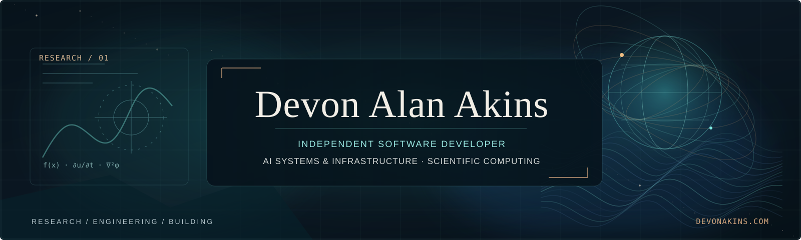

# Devon Alan Akins — public project index

> **Repository index refreshed November 19, 2026.** This is a public source map, not a company incorporation record, production deployment report or complete inventory of private work. The [GitHub profile README](https://github.com/devonalanakins/devonalanakins) is maintained separately.

I build independent open-source software, research tools, interactive media and original writing. My current technical direction emphasizes AI infrastructure, scientific computing, accessible software and practical operational systems.

[Personal website](https://devonakins.com) · [Public GitHub profile](https://github.com/devonalanakins) · [Repository registry](./PROJECT_REGISTRY.md)

## Active and emerging work

| Project | Scope | Evidence and limits |
| --- | --- | --- |
| [ANEVUM](https://github.com/devonalanakins/anevum-web) | Open learning, research and creative work | [Open Institute draft](https://github.com/devonalanakins/anevum-web/pull/816) is a protected non-accredited educational preview, not an operating school or nonprofit |
| [ANEVUM Bonsai Living Atlas](https://github.com/devonalanakins/anevum-web/pull/815) | Seed-grown tree journal and interactive editorial experiments | Isolated draft with illustrative concepts; no authorized apex release |
| [DevonAkins.com](https://github.com/devonalanakins/devonakins.com) | Personal software and science portfolio | Public source, interactive research and review-in-progress features |
| [DevonStation](https://github.com/devonalanakins/devon-station) | Personal systems and communications engineering | Application development; verify branch and release status separately |
| [Knowledge](https://github.com/devonalanakins/knowledge) | Private-first knowledge and file-workspace engineering | Source and review work; no blanket claim of safe production data cutover |
| [Merit](https://github.com/devonalanakins/merit) | Evidence-led software integrity tooling | Source-based tests and review; not an accredited certification service |
| [Rhen](https://github.com/devonalanakins/rhen) | Experimental language tooling and inspectable compilation | [M0 in draft PR #1](https://github.com/devonalanakins/rhen/pull/1), not an available released compiler |
| [Squelch](https://github.com/devonalanakins/squelch) | Touch-first audio and DJ software | Experimental development, not a released workstation |
| [Brandle](https://github.com/devonalanakins/brandle) | Original browser word game | Public project source |

## Preserved and separate work

[Transcosmic: Severance](https://github.com/devonalanakins/severance) retains creative/game research prototypes. [Vesper Legacy](https://github.com/devonalanakins/vesper-legacy) preserves historical quantitative research; it is **not** the new Rhen programming language and makes no investment-performance claim. Other public repositories and older identities remain available in the [registry](./PROJECT_REGISTRY.md), without implying current product support.

**Nona Neuropsychology is an independent professional practice**, not an ANEVUM product. My nonclinical operational and digital work for the practice is governed separately, with appropriate professional oversight and restricted source access. Personal, business, family and sensitive data never belong in public project documentation.

## Engineering principles

I favor readable open-source code, self-hostability where feasible, reproducible tests, accessible user experiences, transparent limitations and proper separation of deployment and security boundaries.

A repository, experimental UI, generated preview or successful local test is **not** proof of production readiness. Verify the owning repository, exact PR/head, CI and deployed service before relying on a status claim.

[Full public source registry](./PROJECT_REGISTRY.md) · [Proposed GitHub repository descriptions (not applied)](./PUBLIC_REPOSITORY_METADATA.md)
